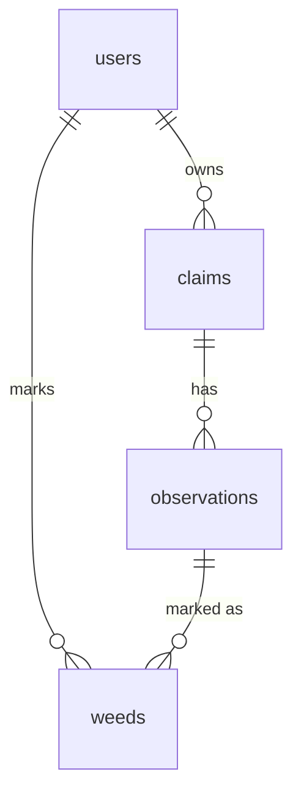

# InfoTracer — Plan, version 2

This is my original plan ([PLAN.md](PLAN.md)) with one section rewritten:
**hosting and deployment**, the biggest gap between my plan and what I
shipped. The new section 5a is written so that an agent with no knowledge of
this project would set up hosting right the first time. Everything else is
unchanged from the original plan; see the Plan vs. Reality table in PLAN.md
for how the rest turned out.

## 1. Pitch

I'm building InfoTracer because by the time a viral claim reaches me, its
origin is usually buried under layers of reposts, screenshots and "I saw
someone say." When a story like "$12 billion was stolen from the bank" shows
up in my feed, the question I always want answered is: where did this actually
start, and who carried it from there?

In my article *Planting Weeds*, I describe how a disinformation campaign
travels: it is injected into the information environment by seeding accounts,
picked up by more established accounts, and finally laundered by key
communicators who spread it to an audience that trusts them. The good news is
that this means disinformation is traceable. Certain key phrases are repeated
verbatim throughout a campaign's life cycle, which lets a researcher follow
them back toward their first appearance. InfoTracer is built around that
method. It lets me log every sighting of a claim, find more sightings
automatically, and work backward toward the earliest one I can find.

A few terms I'll use throughout this plan:

- **Claim:** the story or statement under investigation.
- **Hook:** the distinctive phrase or detail that repeats as the claim spreads,
  such as "$12 billion." This is what I search for.
- **Observation:** a single sighting of the claim: when it appeared, where, and
  who posted it.
- **Seed:** the earliest observation I can find, my best evidence of where the
  claim was planted.
- **Weed:** an observation I assess as intentionally spreading disinformation.
  Not every observation is a weed; many people share a claim because they
  genuinely believe it.

**How often I'll use it:** InfoTracer is a proof of concept for a longer-term
project, so usage will vary, but ideally once a week or more.

## 2. Features

Numbered in the order I'll build them. Features 1–7 are the required spine;
8–10 are my own.

### Required spine features

1. **Sign up and login (Spine #1).** As a researcher, I want to create an
   account and log in and out, so that my claim investigations are private to me.
2. **Data model (Spine #2).** As a researcher, I want each claim to hold a
   chronological list of observations, each recording the time, location
   (platform, such as X or Instagram) and poster (account, organization or
   author), so that I can trace a claim's path from its earliest sighting.
3. **Create / read / update / delete (Spine #3).** As a researcher, I want to
   add a claim with its text, its hook and a status (tracing / traced / dead
   end), then log observations with time, location, poster and a link, so that
   I can build an investigation step by step. I can mark one observation per
   claim as the seed. I can open a claim's detail page, edit it, and delete it
   after an "are you sure?" confirmation.
4. **Validation (Spine #4).** As a researcher, I want to be told if I leave a
   claim's text or an observation's location blank, so that every record is
   usable for tracing.
5. **Weeds (Spine #5: Stars).** As a researcher, I want to mark an observation
   as a weed and see all my weeds in one "Weeds" view, so that I can track who
   is deliberately pushing false claims rather than unknowingly repeating them.
6. **Find things (Spine #6).** As a researcher, I want to search claims by
   text, filter by status or location, and sort by newest or by earliest
   observation, so that I can find an investigation quickly.
7. **Dashboard (Spine #7).** As a researcher, I want to see how many claims
   I've traced, the location where seeds most often appear, and the share of
   observations I've marked as weeds, plus a chart of weeds by location, so
   that I can spot where disinformation is planted and where it's deliberately
   spread.

### My 3 features

8. **Origin timeline (Custom #1).** As a researcher, I want a claim's
   observations shown on a timeline from oldest to newest, with the seed and
   any weeds marked, so that I can see how the claim spread and who amplified it.
9. **Fact-check lookup (Custom #2).** As a researcher, I want a button that
   searches Google's Fact Check database for my claim, so that I can see
   whether fact-checkers have already traced it.
10. **Source search (Custom #3).** As a researcher, I want one search button
    that checks Bluesky, GDELT news and Xpoz behind the scenes and saves
    matching results as observations, each labeled with where it was found and
    with any missing detail shown as "-" for me to fill in, so that the tool
    gives me a starting point without my needing to know which source to search.
    Results from Xpoz are flagged "verify" because they need the closest
    checking.

The automated search is a starting point, not a verdict. Every source has gaps:
posts get deleted, claims jump between platforms, and some spread in private
groups that no tool can reach. That's why every automated observation can be
edited, and why the researcher, not the tool, decides what counts as a seed or
a weed.

## 3. Database

Four tables. Missing values are stored blank and shown in the app as "-".

### users
| Column | Type | Notes |
| --- | --- | --- |
| id | number | **Primary key** |
| email | text | Required, unique |
| password_hash | text | Required; the password is never stored as typed |
| created_at | date | Set automatically |

### claims (main item)
| Column | Type | Notes |
| --- | --- | --- |
| id | number | **Primary key** |
| user_id | number | Links to users.id (the owner) |
| claim_text | text | Required; the claim as I first saw it |
| hook | text | The distinctive phrase to search for, e.g. "$12 billion" |
| status | text | One of: tracing / traced / dead end |
| notes | text | Up to 2,000 characters |
| created_at | date | Set automatically |

### observations (related table)
| Column | Type | Notes |
| --- | --- | --- |
| id | number | **Primary key** |
| claim_id | number | Links to claims.id |
| observed_at | date | Date and time of the post; may be blank |
| location | text | Required; platform, e.g. X, Instagram, a news site |
| poster | text | Account, organization or author; may be blank |
| post_text | text | Exact wording of the post, up to 2,000 characters |
| url | text | Link to the post |
| notes | text | Up to 2,000 characters |
| is_seed | true/false | True for the origin; at most one per claim |
| found_by | text | Where the observation came from: bluesky, gdelt, xpoz or manual |
| created_at | date | Set automatically |

### weeds (junction table; my version of stars)
| Column | Type | Notes |
| --- | --- | --- |
| user_id | number | Links to users.id |
| observation_id | number | Links to observations.id |
| created_at | date | Set automatically |

**Primary key:** user_id + observation_id together, so a user can weed an
observation only once.

### How the tables connect
- **users → claims:** one-to-many. Each user owns many claims; each claim has
  one owner.
- **claims → observations:** one-to-many. Each claim has many observations.
- **users ↔ observations (through weeds):** many-to-many. A user can weed many
  observations, and the weeds table records each one.
- Deleting a claim also deletes its observations and their weeds.



## 4. Tests

**Test 1: Data isolation.** Given User A has created a claim called "$12 billion
stolen from the bank" with two observations, and User B has a separate account
with no claims, when User B logs in and opens their claims list, or tries to
open User A's claim page directly by its link, then User B's list is empty, and
the direct link is refused instead of showing User A's claim.

**Test 2: Dashboard stat.** Given a user has 2 claims with 10 observations in
total, 3 of which are marked as weeds, when the user opens the dashboard, then
the "share of observations marked as weeds" stat shows 30%.

## 5. Technologies

- **Coding agent: Claude (Claude Code).** I'm using Claude to plan and build
  features because it's a leading agentic coding tool: it can work across my
  whole repo, write and run tests, and commit to feature branches and open PRs
  on GitHub, which fits the assignment's feature loop directly.
- **Language and framework: Node.js with Express.** A small, widely used web
  server that an AI agent can build reliably and Replit runs out of the box.
- **Database: PostgreSQL (Replit's built-in database).** It handles the
  relationships between my four tables and lives on the same host as the app.
- **Sign up and login: email and password, built into the app.** Passwords are
  hashed with bcrypt and logins kept with express-session, so every account is
  a row in my own users table, as the assignment requires.
- **Hosting: Replit (Autoscale), deployed from GitHub.** It hosts the app and
  database in one place, but it needs specific setup; see section 5a.
- **Charts: Chart.js.** A free, simple library for the dashboard's weeds-by-
  location chart.
- **Tests: Vitest with Supertest.** They can sign up test users and make
  requests to the app, which is exactly what the data isolation test needs.
- **Google Fact Check Tools API.** Free with an API key; powers the fact-check
  lookup.
- **Bluesky API (searchPosts).** Free, official access with date filters for
  finding early posts, so I can rely on its results being legitimate. It may
  need a Bluesky app password.
- **GDELT DOC 2.0 API.** Free and needs no key; it searches news articles
  rather than social posts, so it shows when a claim reached the press.
- **Xpoz API.** Searches X, Instagram, TikTok and Reddit, where disinformation
  is especially likely to spread. It doesn't disclose how it collects its data,
  so its results are flagged for me to double-check, and I'll remove it if it
  doesn't meet my standards.

## 5a. Hosting and deployment

**Environment.** Replit runs **Node.js 20** and **PostgreSQL 16**. Replit's
database sets `DATABASE_URL` automatically. The app creates its own tables
when it starts, using only "create if missing" statements, so restarts and a
fresh database are safe. The app must listen on `process.env.PORT` at
`0.0.0.0`, trust Replit's HTTPS proxy (`app.set("trust proxy", 1)`), and keep
login sessions in PostgreSQL rather than in memory. That lets the app sleep
and restart without logging anyone out.

**Deploy first.** Publish right after the first feature (sign up and login),
before building anything else, and test it on Replit itself. Settings that
work locally can still fail on Replit.

**The `.replit` file must contain:**

```toml
modules = ["nodejs-20", "web", "postgresql-16"]
run = "npm install --omit=dev --no-audit --no-fund; PORT=5000 npm start"

[deployment]
run = ["sh", "-c", "PORT=5000 npm start"]
build = ["sh", "-c", "npm ci --omit=dev"]
deploymentTarget = "autoscale"

[[ports]]
localPort = 5000
externalPort = 80
```

**What each part prevents:**
- **Port 5000, mapped to 80, in both the Run button and the deployment.**
  This stops the preview from working while the live site fails.
- **The Run button installs packages before starting.** Without it, any PR
  that adds a package breaks the preview, because pulling new code doesn't
  install anything.
- **`deploymentTarget = "autoscale"`.** Without a named target, the Publish
  dialog keeps guessing one.

**Tests run on GitHub Actions, never on Replit.** Replit's package firewall
blocks packages with known critical vulnerabilities, and it installs test
tools before the build step runs. Keep the test runner current (Vitest 5 or
later), and run the tests in GitHub Actions on Node 22 with a PostgreSQL 16
service.

**Secrets go only in Replit Secrets,** never in code or chat:
`SESSION_SECRET`, plus one key per outside service as each feature is built
(`GOOGLE_FACTCHECK_API_KEY`, `BLUESKY_HANDLE`, `BLUESKY_APP_PASSWORD`,
`XPOZ_API_KEY`). A missing key must show a clear "not set up yet" message, not
crash the app.

**Replit's AI agent may diagnose problems but never commits.** If it changes a
file, copy the change into a pull request so GitHub stays the single source
of truth.

**Routine after every merge, in Replit:**
1. In the Shell: `git fetch origin`, then `git reset --hard origin/main`.
2. **Stop**, then **Run**. A running app keeps its old code until it restarts.
3. **Republish.**

**Before the first publish,** delete practice data from the development
database, because Replit copies it into the live database on the first
publish.

## 6. Design

**Style:** I want InfoTracer to feel like an official open-source intelligence
tool, with a dark, data-dense look inspired by professional OSINT work like
Bellingcat's investigation toolkit and Hoaxy's network graphs. Each claim reads
as a case file, each observation as a piece of evidence, and the timeline grows
like a vine from the seed. Surfaces are flat and borders thin, and color is
used only when it means something: green for seeds, red for weeds.

**Colors:**
| Role | Color | Use |
| --- | --- | --- |
| Background | Charcoal #16181C | Page |
| Borders | Slate #34373D | Cards and panels |
| Text | Off-white #E6E4DD / muted gray #9A988F | Main and supporting text |
| Seed | Green #639922 / light green #97C459 | Origin marker, the timeline vine, the logo |
| Weed | Muted red #A32D2D / #E24B4A | Weed marker and card borders |
| Status | Amber #FAC775 | "Tracing" status badges |

**Type:** a clean sans-serif for the interface, and a monospace font for
quoted post text, so the exact wording reads as evidence.

**Logo:** a small green plant icon next to the InfoTracer name, tying the app
to Planting Weeds.

**Inspiration:**
- **Bellingcat's Online Investigation Toolkit:** the serious, research-grade
  tone of professional open-source investigation.
- **Hoaxy** (Indiana University): dark timelines and spread graphs for
  following how a claim travels.
- **Linear** (project tracker): a dark, dense layout that stays readable, with
  restrained color used only for meaning.

## 7. Risks and cuts

**Least sure I can build: Source search (Custom #3).** Searching three outside
services from one button is the most ambitious part of this plan, and each
service brings its own risk:
- **Xpoz** is the least certain. It doesn't disclose how it collects its data,
  so I haven't vetted its results, and its free tier is limited to about 500
  credits (roughly 250 searches on X).
- **Bluesky** search may require logging in with an app password, and results
  are capped per request.
- **GDELT** only lists articles from the last 3 months of a search window, so
  older news coverage may be missed.

If any source fails during a search, the app will show the results from the
others, plus a note saying which source didn't respond.

**What I'll cut first, in order:**
1. **Xpoz**, then **GDELT** from Source search, keeping Bluesky so Custom #3
   still works.
2. **Fact-check lookup (Custom #2)**, since it's helpful but not core to
   tracing.

**Other risks:**
- **Deadline:** the app is due Wednesday, November 4, so each feature stays in
  its own small PR, and the spine features come first.
- **Hosting:** Replit's free plan can publish a live URL, but setup is the
  risk, not cost. Following section 5a and deploying right after the first
  feature catches Replit-only problems while they're still small. If Replit
  can't publish at all, I'll switch to Vercel or Render with Supabase.
- **Blaming the wrong account:** the earliest observation I can find is not
  always the true origin. Posts get deleted and claims cross platforms, so a
  seed is my best evidence, not proof, and the app will always label it as
  "earliest found."

**Future sources (not in this version):** Wayback Machine (to verify when a
page first existed) and Media Cloud (news archive).
