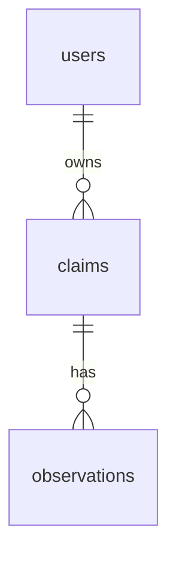

# InfoTracer database schema

InfoTracer stores its data in PostgreSQL. The tables are created automatically
when the app starts (see `src/db.js`). Missing details are stored as empty
(NULL) and shown in the app as "-".

## Tables

### users
One row per account.

| Column | Type | Notes |
| --- | --- | --- |
| id | number | Primary key |
| email | text | Required, unique, stored lowercase |
| password_hash | text | Required; a bcrypt hash, never the password itself |
| created_at | date and time | Set automatically |

### claims
The main item: one row per claim under investigation.

| Column | Type | Notes |
| --- | --- | --- |
| id | number | Primary key |
| user_id | number | The owner; links to users.id |
| claim_text | text | Required |
| hook | text | The distinctive phrase to search for, e.g. "$12 billion" |
| status | text | tracing, traced or dead end; starts as tracing |
| notes | text | Up to 2,000 characters |
| created_at | date and time | Set automatically |

### observations
One row per sighting of a claim.

| Column | Type | Notes |
| --- | --- | --- |
| id | number | Primary key |
| claim_id | number | The claim it belongs to; links to claims.id |
| observed_at | date and time | When it was posted; may be blank |
| location | text | Required; the platform, e.g. X, Instagram, a news site |
| poster | text | Account, organization or author; may be blank |
| post_text | text | Exact wording, up to 2,000 characters |
| url | text | Link to the post |
| notes | text | Up to 2,000 characters |
| is_seed | true/false | True for the claim's origin; at most one per claim |
| found_by | text | bluesky, gdelt, xpoz or manual; starts as manual |
| created_at | date and time | Set automatically |

### weeds
*Coming in Spine #5.* The junction table between users and observations, my
version of stars.

### session
Created by the login system (connect-pg-simple) to keep users signed in. It
isn't part of the app's own data model.

## How the tables relate

- **users → claims: one-to-many.** Each user owns many claims; each claim has
  exactly one owner.
- **claims → observations: one-to-many.** Each claim has many observations,
  listed oldest first, with blank times at the end.
- Deleting a user deletes their claims, and deleting a claim deletes its
  observations.
- Every query in `src/models.js` is filtered by the signed-in user, so no user
  can read or change another user's claims or observations.

## Compared with PLAN.md section 3

The tables built so far match the plan's columns and types. A few rules were
added in the database itself to enforce the plan:

- `status` and `found_by` only accept the values listed in the plan.
- `notes` and `post_text` are capped at 2,000 characters.
- `claim_text` and `location` can't be blank.
- A unique index allows only one seed per claim.
- `observed_at` stores a date *and* time, since posts are timestamped to the
  minute.
